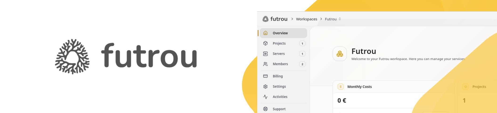

# Futrou CLI

Futrou CLI is a command-line tool for deploying and managing resources on Futrou Cloud — serverlets, proxies, DNS zones, networks, storages, projects and more.

## Installation

### Linux / macOS
```bash
curl -fsSL https://futrou.com/install.sh | bash
```

### Windows (PowerShell)
```powershell
irm https://futrou.com/install.ps1 | iex
```

### npm / npx (Linux, MacOS and Windows)
Requires [Node.js](https://nodejs.org/) and npm.

```bash
npm install -g futrou
# or run without installing
npx futrou --help
```

### Upgrade
```bash
futrou upgrade           # upgrade to latest
futrou upgrade 1.2.0     # upgrade/downgrade to specific version
```

## Supported platforms
- linux/amd64, linux/arm64, darwin/amd64, darwin/arm64, windows/amd64, windows/arm64, freebsd/amd64, freebsd/arm64

## Quick start

```bash
futrou login                       # sign in (opens the browser)
futrou init config                 # create futrou.json (or: -f futrou.yaml)
futrou deploy --dry-run            # show the plan
futrou deploy                      # apply it after confirming (alias: futrou up)
futrou serverlet ls                # list serverlets
futrou logs web                    # stream the logs of the serverlet "web"
futrou down                        # delete everything in the project, then the project
futrou init mcp                    # let AI coding agents use Futrou
futrou init skills
```

Every resource has the same verbs: `ls`, `show`, `create`, `update` and `rm` (the older `list`, `get`, `inspect`, `delete` and plural names such as `serverlets` still work). The full list of commands and flags is in the [commands](#commands).

## Deploying

`futrou deploy` validates `futrou.json`, prints a Terraform-style plan and asks `[y/N]` before applying it. Pass `-y` to skip the prompt (it is skipped automatically when `CI=true`) or `--dry-run` to only show the plan. `futrou up` is an alias. `futrou down` (alias `teardown`) plans the deletion of every resource in the project and then the project itself, with the same confirmation rules.

## Configuration

The project is described in the first of these files found in the current directory (or the one given with `-f`): `futrou.json`, `futrou.js`, `futrou.cjs`, `futrou.mjs`, `futrou.ts`, `futrou.yaml`, `futrou.yml`. YAML is converted to the JSON form and validated the same way. When the CLI updates the file (`config pull`, or the lock refresh after a deploy) it keeps the format; JS and TS configs are code and are never rewritten.

- `region` sets the default region (name or ID) of every resource except DNS; a resource's own `regionId` wins.
- A serverlet's `needs` lists the serverlets it waits for: `db`, `db:started` or `db:healthy`. They are created after, and deleted before, the ones they need.
- A serverlet's `entrypoint` is one string such as `node server.js`.

Every option is set in [examples/futrou.json](examples/futrou.json), [examples/futrou.yaml](examples/futrou.yaml) and [examples/futrou.mjs](examples/futrou.mjs). `futrou init config` creates a starter file.

## Commands

Commands use singular names with `ls` and `rm` (the older plural names, `list` and `delete` still work as hidden aliases).

<!-- cli-reference:start -->

Generated by `make build-docs`; do not edit by hand. `[...]` is optional and `<...>` is a value.
`LOG-OPTIONS` is `[--offset <int>] [--limit <int>] [--search <string>] [--start-at <string>] [--end-at <string>] [--tail] [--live=false]`.

```bash
# global options: --api-url <string>, --api-token|--api-key <string>, --log-level <string>, --local, --dev, --debug

futrou deploy|up [--file|-f <string>] [--yes|-y] [--dry-run] [--destroy]  # Deploy or upgrade resources based on futrou.json|yaml config
futrou down [--file|-f <string>] [--yes|-y] [--dry-run]                   # Deprovision every resource in the project and delete the project
futrou login [--workspace <string>]                                       # Log in to Futrou Cloud on this machine
futrou logout                                                             # Log out from Futrou Cloud on this machine
futrou whoami                                                             # Display the currently authenticated user or api token info

futrou config [--file|-f <string>]                                         # Display the loaded Futrou project configuration as JSON
futrou config init [--file|-f <string>] [--project <string>]               # Create a new Futrou project config with the default project name
futrou config pull [--project|-p <string>] [--file|-f <string>] [--force]  # Fetch a cloud project and write it as a Futrou project config
futrou config schema                                                       # Print the Futrou project config JSON Schema

futrou init [--file|-f <string>] [--name <string>] [--image <string>]         # Set up Futrou in this project (config, mcp, skills)
futrou init mcp                                                               # Configure Futrou MCP for AI coding agents
futrou init skills                                                            # Configure Futrou Skills for AI coding agents
futrou init config [--file|-f <string>] [--name <string>] [--image <string>]  # Configure a futrou.json|yaml config file for this project

futrou workspace ls                                                                      # List all workspaces
futrou workspace show <id>                                                               # Show a workspace by ID
futrou workspace update <id> [--name <string>] [--display-name <string>]                 # Update a workspace
futrou workspace rm <id>                                                                 # Delete a workspace
futrou workspace limit [--workspace <string>]                                            # Get resource limits for a workspace
futrou workspace contact show [--workspace <string>]                                     # Show the workspace billing contact
futrou workspace contact update [--workspace <string>] [--firstname <string>] [--lastname <string>] [--company <string>] [--email <string>] [--phone <string>] [--street-address <string>] [--city <string>] [--postal-code <string>] [--country <string>]  # Update the workspace billing contact
futrou workspace user ls [--workspace <string>]                                          # List users in a workspace
futrou workspace user show <workspace-user-id> [--workspace <string>]                    # Show a user in a workspace
futrou workspace user add [--workspace <string>] --user-id <string> [--role <string>]    # Add a user to a workspace
futrou workspace user update <workspace-user-id> [--workspace <string>] --role <string>  # Update a user's role in a workspace
futrou workspace user rm <workspace-user-id> [--workspace <string>]                      # Remove a user from a workspace

futrou project ls                                                                       # List all projects
futrou project show <id>                                                                # Show a project by ID
futrou project create --name <string> [--display-name <string>] [--workspace <string>]  # Create a project
futrou project update <id> [--name <string>] [--display-name <string>]                  # Update a project
futrou project rm <id>                                                                  # Delete a project

futrou server ls [--region <string>]                                                              # List servers
futrou server show <id>                                                                           # Show a server by ID
futrou server create --name <string> [--region <string>] [--workspace <string>]                   # Create a server in the workspace
futrou server update <id> [--name <string>] [--ipv4 <string>] [--ipv6 <string>] [--api-port <string>]  # Update a server
futrou server rm <id>                                                                             # Delete a server
futrou server reset-join <id>                                                                     # Reset a server's join token
futrou server leave <id>                                                                          # Make a server leave Futrou Cloud
futrou server metrics <id>                                                                        # Show server metrics
futrou server logs <id> [--type <string>] [--id <string>] [--instance-id <string>] [LOG-OPTIONS]  # View server logs

futrou serverlet ls                                                                  # List all serverlets
futrou serverlet show <id>                                                           # Show a serverlet by ID
futrou serverlet create --name <string> --image <string> --plan <string> [--workspace <string>] [--project <string>]  # Create a new serverlet (defaults to futrou.json|yaml, then the login workspace's "default" project)
futrou serverlet update <id> [--name <string>] [--image <string>] [--plan <string>]  # Update a serverlet
futrou serverlet rm <id>                                                             # Delete a serverlet
futrou serverlet start <id>                                                          # Start a serverlet
futrou serverlet stop <id>                                                           # Stop a serverlet
futrou serverlet restart <id>                                                        # Restart a serverlet
futrou serverlet wake <id>                                                           # Wake a sleeping serverlet
futrou serverlet logs <id> [LOG-OPTIONS]                                             # View serverlet logs
futrou serverlet metrics <id>                                                        # Show serverlet metrics
futrou serverlet instance <id>                                                       # Manage serverlet instances
futrou serverlet instance ls <id>                                                    # List serverlet instances
futrou serverlet instance start <id> <instance-id>                                   # Start a serverlet instance
futrou serverlet instance stop <id> <instance-id>                                    # Stop a serverlet instance
futrou serverlet instance restart <id> <instance-id>                                 # Restart a serverlet instance
futrou serverlet instance logs <id> <instance-id> [LOG-OPTIONS]                      # View logs of a serverlet instance
futrou serverlet instance metrics <id> <instance-id>                                 # Show metrics of a serverlet instance
futrou serverlet shell <id> [--instance <string>]                                    # Open an interactive shell in a serverlet
futrou serverlet exec <id> -- <command> [--instance <string>]                        # Run a command in a serverlet and wait for it to exit

futrou network ls                                                                              # List all networks
futrou network show <id>                                                                       # Show a network by ID
futrou network create --name <string> [--ipv4 <string>] [--ipv6 <string>] [--internal] [--region <string>] [--workspace <string>] [--project <string>]  # Create a network (defaults to futrou.json|yaml, then the login workspace's "default" project)
futrou network update <id> [--name <string>] [--ipv4 <string>] [--ipv6 <string>] [--internal]  # Update a network
futrou network rm <id>                                                                         # Delete a network
futrou network devices <id>                                                                    # List devices attached to a network
futrou network metrics <id>                                                                    # Show network metrics

futrou proxy ls                            # List all proxies
futrou proxy show <id>                     # Show a proxy by ID
futrou proxy create --domain <string> --target <string> [--port <int>] [--type <string>] [--strategy <string>] [--https]  # Create a new proxy
futrou proxy update <id> [--domain <string>] [--target <string>] [--port <int>] [--type <string>] [--https]  # Update a proxy
futrou proxy rm <id>                       # Delete a proxy
futrou proxy purge <id>                    # Purge cached responses for a proxy
futrou proxy metrics <id>                  # Get metrics for a proxy
futrou proxy logs <id> [LOG-OPTIONS]       # View logs for a proxy
futrou proxy logs tail <id> [LOG-OPTIONS]  # View recent logs for a proxy

futrou dns ls                                 # List all DNS zones
futrou dns show <id>                          # Show a DNS zone by ID
futrou dns create --name <string>             # Create a DNS zone
futrou dns update <id> [--name <string>]      # Update a DNS zone
futrou dns rm <id>                            # Delete a DNS zone
futrou dns metrics <id>                       # Get metrics for a DNS zone
futrou dns logs <id> [LOG-OPTIONS]            # View logs for a DNS zone
futrou dns logs tail <id> [LOG-OPTIONS]       # View recent logs for a DNS zone
futrou dns record ls <zone-id>                # List records in a DNS zone
futrou dns record show <zone-id> <record-id>  # Show a DNS record
futrou dns record create <zone-id> --name <string> --type <string> --value <string> [--ttl <int>] [--priority <int>]  # Create a DNS record
futrou dns record update <zone-id> <record-id> [--name <string>] [--type <string>] [--value <string>] [--ttl <int>] [--priority <int>]  # Update a DNS record
futrou dns record rm <zone-id> <record-id>    # Delete a DNS record

futrou storage ls [--workspace <string>] [--project <string>]                                      # List storages in a project (defaults to futrou.json|yaml, then the login workspace's "default" project)
futrou storage show <id>                                                                           # Show a storage by ID
futrou storage create --name <string> --plan <string> [--workspace <string>] [--project <string>]  # Create a storage (defaults to futrou.json|yaml, then the login workspace's "default" project)
futrou storage update <id> [--name <string>] [--plan <string>]                                     # Update a storage
futrou storage rm <id>                                                                             # Delete a storage
futrou storage instance <id>                                                                       # Manage storage instances
futrou storage instance ls <id>                                                                    # List storage instances
futrou storage metrics <id>                                                                        # Get storage metrics
futrou storage logs <id> [LOG-OPTIONS]                                                             # View storage logs
futrou storage plan ls                                                                             # List all storage plans
futrou storage plan show <id>                                                                      # Show a storage plan by ID
futrou storage file ls <storage-id> [path-or-glob] [--query <string>]                              # List or search files in a storage; the path may be a glob (e.g. images/*, **/*.log)
futrou storage file info <storage-id> <path>                                                       # Inspect file or folder metadata
futrou storage file download <storage-id> <remote-path-or-glob> <local-path>                       # Download a file, folder, or glob match from a storage
futrou storage file upload <storage-id> <local-path-or-glob> <remote-path>                         # Upload a file, folder, or glob match to a storage
futrou storage file mkdir <storage-id> <path>                                                      # Create a folder in a storage
futrou storage file move <storage-id> <path> <destination>                                         # Move or rename a file or folder in a storage
futrou storage file rm <storage-id> <path-or-glob> [--recursive]                                   # Delete a file, folder, or glob match in a storage
futrou storage sync <storage-id> [remote-path] [local-dir] [--dry-run]                             # Two-way sync between a local directory and a storage path by modification time

futrou logs <name-or-id> [--type|-t <string>] [--instance <string>] [--ls] [LOG-OPTIONS]  # Browse logs of all services
futrou upgrade [version]                                                                  # Upgrade Futrou CLI to the latest or a specific version
futrou schema [--format <string>]                                                         # Display the Futrou API v2 OpenAPI schema
futrou version                                                                            # Display the Futrou CLI version
futrou license                                                                            # Display the Futrou CLI license
```

<!-- cli-reference:end -->

## Agent Skill

Install the Futrou skill for your AI coding agent (Claude Code, Cursor, Copilot, Codex, and 14+ others):

```bash
npx skills add futrou/futrou-cli
```

The skill teaches your agent how to use the Futrou CLI and REST API — deploying serverlets, managing proxies, DNS, networks, storages, projects, and the MCP server at `mcp.futrou.com`.

## Development

### Requirements
- **Go 1.27+**

### Setup
```bash
# macOS
brew install go

# Ubuntu/Debian
sudo snap install go --classic
```

Go 1.27 or newer is required (see `go.mod`). Install it from [go.dev/dl](https://go.dev/dl/) if your package manager ships an older version.

```bash
git clone git@github.com/futrou/futrou-cli.git
make install
```

Run the dev server (auto-rebuilds on changes):
```bash
make
```

### Build
```bash
make build        # build all platforms (also regenerates the schema and the command reference)
make build-docs   # regenerate the command reference in README.md and SKILL.md
make build-npm    # build npm-distributable package
make release      # build all platforms + npm
```

### Start
```bash
make start
make start login
make start serverlet ls
make start ARGS="--help"
```

### Tests
```bash
make test
go test ./src/commands/... -v
```

## Release

Steps to release a new version:
1. Bump the version in `.env` using `make version bump` or set it manually with `make version set 1.2.0`
2. Create a new tag in the format `v{version}` — e.g. `v1.2.0`
3. Push the tag to GitHub: `git push origin v1.2.0`
4. The release pipeline will build binaries for all platforms and publish the release
5. Done

## License
[MIT License](LICENSE)
